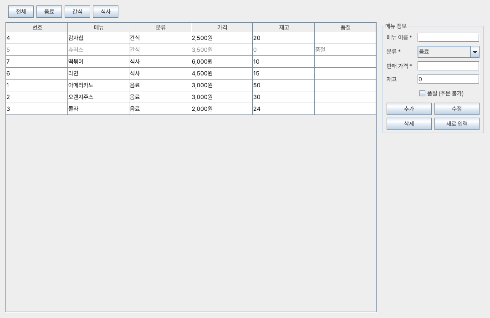
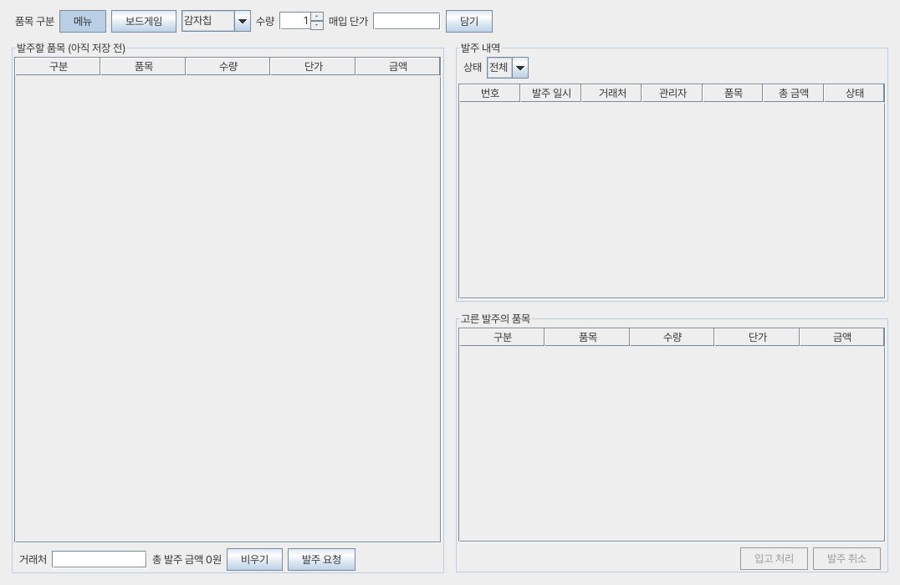

# 개발 지침서 — ④ 박준영

**만드는 것**: 공통 뼈대(DB 연결, 안내창, POS 메인 창) · [관리자] 메뉴 관리 · [관리자] 발주 관리(메뉴·보드게임)

1단계부터 순서대로 따라 한다. 단계마다 **할 일 → 코드 → 확인**이 있고, 확인이 되면 다음 단계로 넘어간다.
코드는 아래 상자에 있는 것을 그대로 복사해 붙이면 된다. 같은 파일은 [④박준영_코드](④박준영_코드/src/dicepos) 폴더에도 있다.
각 단계에 나오는 낱말의 뜻은 [개념 설명서](14_개념설명서_④박준영.md)의 같은 번호를 보면 된다.

## 한눈에 보기

| 단계 | 주차 | 만드는 것 | 다 되면 |
|---|---|---|---|
| 0 | 10주차 | 준비물 확인, DB 만들기 | Workbench에 테이블 17개 |
| 1 | 10주차 | Eclipse 프로젝트, 패키지 4개 | 왼쪽에 `dicepos.common` 등 4개 |
| 2 | 10주차 | DB 연결 `DBUtil` | "연결 성공! 메뉴 7개" |
| 3 | 10주차 | 안내창·금액 도구 `UIUtil` | 빨간 줄 없음 |
| 4 | 10주차 | 팀원 것 임시 파일 4개 | 빨간 줄 없음 |
| 5 | 10주차 | POS 메인 창 | 빈 POS 창이 뜸 → **팀에 공유** |
| 6 | 11주차 | 메뉴 DTO·DAO | 콘솔에 메뉴 7줄 |
| 7 | 11주차 | 메뉴 관리 화면 | 추가·수정·품절·삭제가 됨 |
| 8 | 12주차 | 발주 DTO 3개 | 빨간 줄 없음 |
| 9 | 12주차 | 발주 DAO | 빨간 줄 없음 |
| 10 | 12주차 | 입고 확인 팝업 | 빨간 줄 없음 |
| 11 | 12~13주차 | 발주 관리 화면 | 발주 → 입고 → 재고 증가 |
| 12 | 13주차 | ⑥에게 재고 기능 알려 주기 | ⑥이 주문하면 재고가 줄어듦 |
| 13 | 13주차 | 팀원 화면 합치기 | 메인 창에 모든 화면 |
| 14 | 14주차 | 통합 테스트 | 체크리스트 전부 ☑ |
| 15 | 14~15주차 | 결과보고서·시연 준비 | 예상 질문에 답할 수 있음 |

---

## 0단계. 준비물 확인 (10주차)

**할 일**
1. 컴퓨터에 아래 4가지가 있는지 확인한다. 없으면 설치한다.
   - JDK 17
   - Eclipse IDE for Java Developers
   - MySQL Community Server 8.0 + MySQL Workbench 8.0 (설치할 때 정한 root 비밀번호를 적어 둔다)
   - `mysql-connector-j` jar 파일 (MySQL 홈페이지 → Connector/J → Platform Independent → ZIP을 받아 압축을 푼다)
2. [DB 만들기 문서](../DB만들기/14_DB만들기_④박준영.md)의 1단계를 따라 `dicepos_schema.sql`을 실행한다.

**확인**: Workbench 왼쪽 `SCHEMAS` → `dicepos` → `Tables`에 테이블이 17개 있다.

---

## 1단계. Eclipse 프로젝트 만들기 (10주차)

**할 일**
1. 한글이 깨지지 않게 먼저 설정한다: `Window` → `Preferences` → `General` → `Workspace` → 아래쪽 `Text file encoding`에서 `Other` → `UTF-8` → `Apply and Close`
   (Mac은 `Eclipse` → `Settings`)
2. `File` → `New` → `Java Project`
3. `Project name`에 `DicePOS`를 쓴다.
4. `JRE`에서 `JavaSE-17`을 고른다.
5. `Create module-info.java file`의 체크를 **끈다**.
6. `Finish`
7. 프로젝트 `DicePOS`를 오른쪽 클릭 → `Build Path` → `Configure Build Path` → `Libraries` 탭 → `Classpath`를 한 번 클릭 → `Add External JARs…` → `mysql-connector-j-8.x.x.jar` 선택 → `Apply and Close`
8. `src`를 오른쪽 클릭 → `New` → `Package` → 이름을 쓰고 `Finish`. 이것을 4번 한다.
   - `dicepos.common`
   - `dicepos.main`
   - `dicepos.menu`
   - `dicepos.game`

**확인**: 왼쪽 `src` 아래에 패키지 4개가 보이고, `Referenced Libraries`에 jar가 보인다.

> **클래스 만드는 방법** (앞으로 계속 쓴다): 패키지를 오른쪽 클릭 → `New` → `Class` → `Name`에 클래스 이름 → `Finish` → 생긴 내용을 **전부 지우고** 아래 코드를 붙여 넣는다 → `Ctrl + S`로 저장

---

## 2단계. DB 연결 — `DBUtil` (10주차)

**할 일**
1. `dicepos.common`에 `DBUtil` 클래스를 만들고 아래 코드를 붙여 넣는다.
2. `"본인 root 비밀번호"` 부분을 0단계에서 적어 둔 root 비밀번호로 바꾼다. (따옴표는 남긴다)
3. 같은 패키지에 `DBTest` 클래스를 만든다.
4. `DBTest.java`를 오른쪽 클릭 → `Run As` → `Java Application`

`dicepos/common/DBUtil.java`
```java
package dicepos.common;

import java.sql.Connection;
import java.sql.DriverManager;
import java.sql.SQLException;

/** DB 연결을 만들어 주는 클래스. 팀원 모두 DB에 접속할 때 이 클래스만 쓴다. */
public class DBUtil {
    private static final String URL =
        "jdbc:mysql://localhost:3306/dicepos?serverTimezone=Asia/Seoul&characterEncoding=UTF-8";
    private static final String USER = "root";
    private static final String PASSWORD = "본인 root 비밀번호";

    public static Connection getConnection() throws SQLException {
        return DriverManager.getConnection(URL, USER, PASSWORD);
    }
}
```

`dicepos/common/DBTest.java` (연결 확인용, 확인이 끝나면 지워도 된다)
```java
package dicepos.common;

import java.sql.Connection;
import java.sql.PreparedStatement;
import java.sql.ResultSet;
import java.sql.SQLException;

public class DBTest {
    public static void main(String[] args) {
        try (Connection con = DBUtil.getConnection();
             PreparedStatement ps = con.prepareStatement("SELECT COUNT(*) FROM menu");
             ResultSet rs = ps.executeQuery()) {
            rs.next();
            System.out.println("연결 성공! 메뉴 " + rs.getInt(1) + "개");
        } catch (SQLException ex) {
            System.out.println("연결 실패: " + ex.getMessage());
        }
    }
}
```

**확인**: 아래 `Console` 창에 `연결 성공! 메뉴 7개`

**막히면**

| 콘솔에 나온 말 | 고치는 방법 |
|---|---|
| `No suitable driver` | 1단계 7번(jar 추가)을 다시 한다 |
| `Access denied for user` | 2번의 비밀번호가 틀렸다 |
| `Communications link failure` | MySQL이 꺼져 있다. Workbench로 접속되는지 본다 |
| `Unknown database 'dicepos'` | 0단계 2번(SQL 실행)을 안 했다 |
| 한글이 `???`로 나온다 | 1단계 1번(UTF-8)을 다시 한다 |

---

## 3단계. 안내창·금액 도구 — `UIUtil` (10주차)

모든 화면에서 같이 쓰는 기능이다. 팀원들도 이것을 쓴다.

**할 일**: `dicepos.common`에 `UIUtil` 클래스를 만들고 붙여 넣는다.

`dicepos/common/UIUtil.java`
```java
package dicepos.common;

import java.awt.Component;
import java.text.DecimalFormat;
import javax.swing.JOptionPane;

/** 안내창과 금액 표시처럼 모든 화면에서 같이 쓰는 기능. */
public class UIUtil {
    private static final DecimalFormat WON = new DecimalFormat("#,###");

    /** 3000 → "3,000원" */
    public static String won(int amount) {
        return WON.format(amount) + "원";
    }

    public static void warn(Component parent, String message) {
        JOptionPane.showMessageDialog(parent, message, "확인", JOptionPane.WARNING_MESSAGE);
    }

    public static void info(Component parent, String message) {
        JOptionPane.showMessageDialog(parent, message, "알림", JOptionPane.INFORMATION_MESSAGE);
    }

    /** [예]를 누르면 true */
    public static boolean confirm(Component parent, String message) {
        int answer = JOptionPane.showConfirmDialog(parent, message, "확인", JOptionPane.YES_NO_OPTION);
        return answer == JOptionPane.YES_OPTION;
    }

    /** "3,000" → 3000, 숫자가 아니면 null */
    public static Integer toInt(String text) {
        try {
            return Integer.parseInt(text.trim().replace(",", ""));
        } catch (NumberFormatException e) {
            return null;
        }
    }
}
```

**확인**: 파일에 빨간 줄이 없다.

---

## 4단계. 팀원 것 임시 파일 4개 (10주차)

내 화면은 ① 김재민의 `Session`(지금 누가 쓰는지)과 ③ 김은별의 `GameDAO`(보드게임)를 쓴다. 팀원 것이 아직 없어도 내 화면을 시험할 수 있게 **모양만 같은 임시 파일**을 만든다. 팀원이 진짜 파일을 올리면 13단계에서 이 4개를 지운다.

**할 일**: 아래 4개를 각 패키지에 만든다.

`dicepos/common/Session.java` (① 김재민 것 임시)
```java
package dicepos.common;

/**
 * ※ 임시 파일입니다. ① 김재민이 진짜 Session을 올리면 이 파일은 지우고 그것을 씁니다.
 * 지금 POS를 쓰는 직원과, 관리자 확인을 통과한 관리자 번호를 기억한다.
 */
public class Session {
    private static int staffId = 3;          // 임시: 박민서 (직원)
    private static String staffName = "박민서";
    private static int adminId = 0;           // 0이면 관리자 화면이 잠겨 있다는 뜻

    public static int getStaffId() { return staffId; }
    public static String getName() { return staffName; }

    public static boolean isAdminUnlocked() { return adminId != 0; }
    public static int getAdminId() { return adminId; }
    public static void unlockAdmin(int id) { adminId = id; }
    public static void lockAdmin() { adminId = 0; }
}
```

`dicepos/common/AuthDialog.java` (① 김재민 것 임시)
```java
package dicepos.common;

import java.awt.Component;
import javax.swing.JOptionPane;

/**
 * ※ 임시 파일입니다. ① 김재민이 진짜 관리자 확인 팝업을 올리면 이 파일은 지웁니다.
 * 지금은 확인 없이 1번 관리자(김지우)로 통과시킨다.
 */
public class AuthDialog {
    public static boolean confirmAdmin(Component parent) {
        JOptionPane.showMessageDialog(parent,
            "관리자 확인 팝업은 ① 김재민이 만듭니다.\n지금은 임시로 1번 관리자로 통과합니다.");
        Session.unlockAdmin(1);
        return true;
    }
}
```

`dicepos/game/GameDTO.java` (③ 김은별 것 임시)
```java
package dicepos.game;

/** ※ 임시 파일입니다. ③ 김은별이 진짜 GameDTO를 올리면 지웁니다. */
public class GameDTO {
    private final int gameId;
    private final String name;
    private final int stock;
    private final String status;

    public GameDTO(int gameId, String name, int stock, String status) {
        this.gameId = gameId;
        this.name = name;
        this.stock = stock;
        this.status = status;
    }

    public int getGameId() { return gameId; }
    public String getName() { return name; }
    public int getStock() { return stock; }
    public String getStatus() { return status; }
}
```

`dicepos/game/GameDAO.java` (③ 김은별 것 임시)
```java
package dicepos.game;

import dicepos.common.DBUtil;
import java.sql.Connection;
import java.sql.PreparedStatement;
import java.sql.ResultSet;
import java.sql.SQLException;
import java.util.ArrayList;
import java.util.List;

/**
 * ※ 임시 파일입니다. ③ 김은별이 진짜 GameDAO를 올리면 이 파일은 지웁니다.
 * ④ 발주 관리가 쓰는 두 메서드만 들어 있다.
 */
public class GameDAO {
    public List<GameDTO> findAll() throws SQLException {
        String sql = "SELECT game_id, name, stock, status FROM game ORDER BY name";
        List<GameDTO> list = new ArrayList<>();
        try (Connection con = DBUtil.getConnection();
             PreparedStatement ps = con.prepareStatement(sql);
             ResultSet rs = ps.executeQuery()) {
            while (rs.next()) {
                list.add(new GameDTO(rs.getInt("game_id"), rs.getString("name"),
                                     rs.getInt("stock"), rs.getString("status")));
            }
        }
        return list;
    }

    /** 입고할 때 부른다. 받은 Connection(발주 트랜잭션)을 그대로 쓴다. 폐기였던 게임은 정상으로 돌린다. */
    public void increaseStock(Connection con, int gameId, int qty) throws SQLException {
        String sql = "UPDATE game SET stock = stock + ?, "
                   + "status = CASE WHEN status = '폐기' THEN '정상' ELSE status END WHERE game_id = ?";
        try (PreparedStatement ps = con.prepareStatement(sql)) {
            ps.setInt(1, qty);
            ps.setInt(2, gameId);
            ps.executeUpdate();
        }
    }
}
```

**확인**: 4개 파일 모두 빨간 줄이 없다.

---

## 5단계. POS 메인 창 (10주차)

왼쪽 메뉴 버튼을 누르면 가운데 화면이 바뀌는 창이다. 팀원 6명의 화면이 모두 여기에 붙는다.

**할 일**
1. `dicepos.main`에 `PosMainFrame`을 만든다.
2. `dicepos.main`에 `PosMain`을 만든다. 아직 메뉴·발주 화면이 없으므로 **두 줄 앞에 `//`가 붙은 상태**로 붙여 넣는다.
3. `PosMain.java`를 오른쪽 클릭 → `Run As` → `Java Application`

`dicepos/main/PosMainFrame.java`
```java
package dicepos.main;

import dicepos.common.AuthDialog;
import dicepos.common.Session;
import java.awt.BorderLayout;
import java.awt.CardLayout;
import java.awt.Color;
import java.awt.Dimension;
import java.awt.Font;
import java.awt.GridLayout;
import javax.swing.BorderFactory;
import javax.swing.BoxLayout;
import javax.swing.JButton;
import javax.swing.JFrame;
import javax.swing.JLabel;
import javax.swing.JPanel;
import javax.swing.SwingConstants;

/** POS 메인 창. 왼쪽은 메뉴 버튼, 가운데는 팀원들의 화면이 카드처럼 바뀐다. */
public class PosMainFrame extends JFrame {
    private final CardLayout cards = new CardLayout();
    private final JPanel center = new JPanel(cards);
    private final JPanel staffMenu = new JPanel(new GridLayout(0, 1, 0, 6));
    private final JPanel adminMenu = new JPanel(new GridLayout(0, 1, 0, 6));
    private final JLabel lockLabel = new JLabel("관리자 화면 (잠김)");

    public PosMainFrame() {
        super("다이스 POS");
        setDefaultCloseOperation(JFrame.EXIT_ON_CLOSE);
        setSize(1300, 812);
        setLocationRelativeTo(null);   // 화면 가운데

        JLabel home = new JLabel("왼쪽에서 화면을 고르세요", SwingConstants.CENTER);
        home.setFont(new Font("맑은 고딕", Font.PLAIN, 22));
        center.add(home, "처음");

        add(makeSide(), BorderLayout.WEST);
        add(center, BorderLayout.CENTER);
    }

    private JPanel makeSide() {
        JPanel side = new JPanel(new BorderLayout());
        side.setPreferredSize(new Dimension(220, 0));
        side.setBackground(new Color(30, 42, 74));
        side.setBorder(BorderFactory.createEmptyBorder(16, 12, 16, 12));

        JLabel title = new JLabel("다이스 POS");
        title.setForeground(Color.WHITE);
        title.setFont(new Font("맑은 고딕", Font.BOLD, 20));

        JPanel list = new JPanel();
        list.setLayout(new BoxLayout(list, BoxLayout.Y_AXIS));
        list.setOpaque(false);
        staffMenu.setOpaque(false);
        adminMenu.setOpaque(false);
        list.add(sectionLabel(new JLabel("직원 화면")));
        list.add(staffMenu);
        list.add(sectionLabel(lockLabel));
        list.add(adminMenu);

        JLabel who = new JLabel("근무자 " + Session.getName());
        who.setForeground(Color.WHITE);

        side.add(title, BorderLayout.NORTH);
        side.add(list, BorderLayout.CENTER);
        side.add(who, BorderLayout.SOUTH);
        return side;
    }

    private JLabel sectionLabel(JLabel label) {
        label.setForeground(new Color(170, 185, 220));
        label.setBorder(BorderFactory.createEmptyBorder(14, 0, 6, 0));
        return label;
    }

    /** 팀원 화면을 메인 창에 붙인다. admin이 true면 관리자 화면 쪽에 버튼이 생긴다. */
    public void addScreen(String name, JPanel screen, boolean admin) {
        center.add(screen, name);
        JButton button = new JButton(name);
        button.addActionListener(e -> open(name, admin));
        (admin ? adminMenu : staffMenu).add(button);
        revalidate();
    }

    private void open(String name, boolean admin) {
        if (admin && !Session.isAdminUnlocked()) {
            if (!AuthDialog.confirmAdmin(this)) return;   // 관리자 확인 실패
        }
        if (!admin) Session.lockAdmin();                  // 직원 화면으로 오면 다시 잠금
        lockLabel.setText(Session.isAdminUnlocked() ? "관리자 화면 (열림)" : "관리자 화면 (잠김)");
        cards.show(center, name);
    }
}
```

`dicepos/main/PosMain.java` (지금 붙여 넣을 모양)
```java
package dicepos.main;

// import dicepos.menu.MenuPanel;            // 7단계에서 맨 앞 // 를 지운다
// import dicepos.menu.PurchaseOrderPanel;   // 11단계에서 맨 앞 // 를 지운다
import javax.swing.SwingUtilities;

/** POS 프로그램을 시작하는 곳. 팀원 화면이 완성되면 여기에 한 줄씩 추가한다. */
public class PosMain {
    public static void main(String[] args) {
        SwingUtilities.invokeLater(() -> {
            PosMainFrame frame = new PosMainFrame();
            // 직원 화면 (⑤ ⑥ ② ③이 완성하면 추가)
            // frame.addScreen("테이블 현황", new TableStatusPanel(), false);
            // 관리자 화면
            // frame.addScreen("메뉴 관리", new MenuPanel(), true);          // 7단계
            // frame.addScreen("발주 관리", new PurchaseOrderPanel(), true);  // 11단계
            frame.setVisible(true);
        });
    }
}
```

**확인**: 왼쪽은 남색, 가운데에 "왼쪽에서 화면을 고르세요"가 있는 창이 뜬다.

**팀에 공유하기 (10주차 안에)**: `dicepos.common`, `dicepos.main` 폴더를 팀 저장소에 올리고 아래를 알린다.
> 각자 화면은 `JPanel`을 상속해서 만들고, `PosMain`에 `frame.addScreen("화면 이름", new 내화면(), 관리자화면이면 true);` 한 줄만 추가하면 메인 창에 붙습니다. DB 연결은 `DBUtil.getConnection()`, 안내창은 `UIUtil.warn / info / confirm`을 쓰세요.

---

## 6단계. 메뉴 DTO·DAO (11주차)

DTO는 메뉴 한 줄을 담는 그릇, DAO는 menu 테이블에 일을 시키는 클래스다.

**할 일**
1. `dicepos.menu`에 `MenuDTO`, `MenuDAO`를 만든다.
2. 시험용 `MenuDAOTest`를 만들어 실행한다.

`dicepos/menu/MenuDTO.java`
```java
package dicepos.menu;

/** menu 테이블의 한 줄을 담는 그릇. */
public class MenuDTO {
    private int menuId;
    private String name;
    private String category;
    private int price;
    private int stock;
    private boolean soldOut;

    public MenuDTO(int menuId, String name, String category, int price, int stock, boolean soldOut) {
        this.menuId = menuId;
        this.name = name;
        this.category = category;
        this.price = price;
        this.stock = stock;
        this.soldOut = soldOut;
    }

    public int getMenuId() { return menuId; }
    public String getName() { return name; }
    public String getCategory() { return category; }
    public int getPrice() { return price; }
    public int getStock() { return stock; }
    public boolean isSoldOut() { return soldOut; }
}
```

`dicepos/menu/MenuDAO.java`
```java
package dicepos.menu;

import dicepos.common.DBUtil;
import java.sql.Connection;
import java.sql.PreparedStatement;
import java.sql.ResultSet;
import java.sql.SQLException;
import java.sql.Statement;
import java.util.ArrayList;
import java.util.List;

/** menu 테이블에 일을 시키는 클래스. menu를 바꾸는 SQL은 모두 여기에만 있다. */
public class MenuDAO {

    public List<MenuDTO> findAll() throws SQLException {
        return query("SELECT * FROM menu ORDER BY category, name", null);
    }

    /** ⑥ 김하진도 메뉴 버튼을 만들 때 쓴다. */
    public List<MenuDTO> findByCategory(String category) throws SQLException {
        return query("SELECT * FROM menu WHERE category = ? ORDER BY name", category);
    }

    private List<MenuDTO> query(String sql, String category) throws SQLException {
        List<MenuDTO> list = new ArrayList<>();
        try (Connection con = DBUtil.getConnection();
             PreparedStatement ps = con.prepareStatement(sql)) {
            if (category != null) ps.setString(1, category);
            try (ResultSet rs = ps.executeQuery()) {
                while (rs.next()) {
                    list.add(new MenuDTO(rs.getInt("menu_id"), rs.getString("name"),
                            rs.getString("category"), rs.getInt("price"),
                            rs.getInt("stock"), rs.getBoolean("sold_out")));
                }
            }
        }
        return list;
    }

    /** 새 메뉴를 넣고, DB가 만든 메뉴 번호를 돌려준다. */
    public int insert(MenuDTO m) throws SQLException {
        String sql = "INSERT INTO menu (name, category, price, stock, sold_out) VALUES (?, ?, ?, ?, ?)";
        try (Connection con = DBUtil.getConnection();
             PreparedStatement ps = con.prepareStatement(sql, Statement.RETURN_GENERATED_KEYS)) {
            ps.setString(1, m.getName());
            ps.setString(2, m.getCategory());
            ps.setInt(3, m.getPrice());
            ps.setInt(4, m.getStock());
            ps.setBoolean(5, m.isSoldOut());
            ps.executeUpdate();
            try (ResultSet keys = ps.getGeneratedKeys()) {
                keys.next();
                return keys.getInt(1);
            }
        }
    }

    public void update(MenuDTO m) throws SQLException {
        String sql = "UPDATE menu SET name = ?, category = ?, price = ?, stock = ?, sold_out = ? WHERE menu_id = ?";
        try (Connection con = DBUtil.getConnection();
             PreparedStatement ps = con.prepareStatement(sql)) {
            ps.setString(1, m.getName());
            ps.setString(2, m.getCategory());
            ps.setInt(3, m.getPrice());
            ps.setInt(4, m.getStock());
            ps.setBoolean(5, m.isSoldOut());
            ps.setInt(6, m.getMenuId());
            ps.executeUpdate();
        }
    }

    public void setSoldOut(int menuId, boolean soldOut) throws SQLException {
        try (Connection con = DBUtil.getConnection();
             PreparedStatement ps = con.prepareStatement("UPDATE menu SET sold_out = ? WHERE menu_id = ?")) {
            ps.setBoolean(1, soldOut);
            ps.setInt(2, menuId);
            ps.executeUpdate();
        }
    }

    /** 이 메뉴를 가리키는 기록 수 (주문 상세 + 결제 상세 + 발주 상세). 0일 때만 지울 수 있다. */
    public int countUsage(int menuId) throws SQLException {
        String sql = "SELECT (SELECT COUNT(*) FROM order_detail WHERE menu_id = ?)"
                   + " + (SELECT COUNT(*) FROM payment_detail WHERE menu_id = ?)"
                   + " + (SELECT COUNT(*) FROM purchase_order_detail WHERE menu_id = ?)";
        try (Connection con = DBUtil.getConnection();
             PreparedStatement ps = con.prepareStatement(sql)) {
            ps.setInt(1, menuId);
            ps.setInt(2, menuId);
            ps.setInt(3, menuId);
            try (ResultSet rs = ps.executeQuery()) {
                rs.next();
                return rs.getInt(1);
            }
        }
    }

    public void delete(int menuId) throws SQLException {
        try (Connection con = DBUtil.getConnection();
             PreparedStatement ps = con.prepareStatement("DELETE FROM menu WHERE menu_id = ?")) {
            ps.setInt(1, menuId);
            ps.executeUpdate();
        }
    }

    /**
     * ⑥ 김하진이 주문을 저장할 때 같은 Connection을 넘겨서 부른다.
     * 재고가 모자라면 예외를 던지고, ⑥은 그 예외를 받아 주문 전체를 rollback 한다.
     */
    public void decreaseStock(Connection con, int menuId, int qty) throws SQLException {
        try (PreparedStatement ps = con.prepareStatement(
                "UPDATE menu SET stock = stock - ? WHERE menu_id = ? AND stock >= ?")) {
            ps.setInt(1, qty);
            ps.setInt(2, menuId);
            ps.setInt(3, qty);
            if (ps.executeUpdate() == 0) {
                throw new SQLException("재고가 부족합니다. (메뉴 번호 " + menuId + ")");
            }
        }
        try (PreparedStatement ps = con.prepareStatement(
                "UPDATE menu SET sold_out = 1 WHERE menu_id = ? AND stock = 0")) {
            ps.setInt(1, menuId);
            ps.executeUpdate();
        }
    }

    /** 입고(④)와 주문 취소(⑥)에서 부른다. 재고가 생기면 품절을 푼다. */
    public void increaseStock(Connection con, int menuId, int qty) throws SQLException {
        try (PreparedStatement ps = con.prepareStatement(
                "UPDATE menu SET stock = stock + ?, sold_out = 0 WHERE menu_id = ?")) {
            ps.setInt(1, qty);
            ps.setInt(2, menuId);
            ps.executeUpdate();
        }
    }
}
```

`dicepos/menu/MenuDAOTest.java` (확인용, 끝나면 지워도 된다)
```java
package dicepos.menu;

public class MenuDAOTest {
    public static void main(String[] args) throws Exception {
        for (MenuDTO m : new MenuDAO().findAll()) {
            System.out.println(m.getMenuId() + " " + m.getName() + " " + m.getPrice()
                    + "원 재고 " + m.getStock() + (m.isSoldOut() ? " (품절)" : ""));
        }
    }
}
```

**확인**: 콘솔에 7줄이 나온다.
```
4 감자칩 2500원 재고 20
5 츄러스 3500원 재고 0 (품절)
7 떡볶이 6000원 재고 10
6 라면 4500원 재고 15
1 아메리카노 3000원 재고 50
2 오렌지주스 3000원 재고 30
3 콜라 2000원 재고 24
```

---

## 7단계. 메뉴 관리 화면 (11주차)

**할 일**
1. `dicepos.menu`에 `MenuPanel`을 만든다.
2. `PosMain.java`에서 `import dicepos.menu.MenuPanel;` 줄과 `frame.addScreen("메뉴 관리", ...)` 줄 맨 앞의 `//`를 지운다.
3. `PosMain`을 실행하고 왼쪽 `메뉴 관리`를 누른다. 임시 관리자 확인 안내가 뜨면 `확인`.

`dicepos/menu/MenuPanel.java`
```java
package dicepos.menu;

import dicepos.common.UIUtil;
import java.awt.BorderLayout;
import java.awt.Color;
import java.awt.Component;
import java.awt.FlowLayout;
import java.awt.GridBagConstraints;
import java.awt.GridBagLayout;
import java.awt.GridLayout;
import java.awt.Insets;
import java.sql.SQLException;
import java.sql.SQLIntegrityConstraintViolationException;
import java.util.ArrayList;
import java.util.List;
import javax.swing.BorderFactory;
import javax.swing.JButton;
import javax.swing.JCheckBox;
import javax.swing.JComboBox;
import javax.swing.JComponent;
import javax.swing.JLabel;
import javax.swing.JPanel;
import javax.swing.JScrollPane;
import javax.swing.JTable;
import javax.swing.JTextField;
import javax.swing.ListSelectionModel;
import javax.swing.table.DefaultTableCellRenderer;
import javax.swing.table.DefaultTableModel;

/** [관리자] 메뉴 관리 화면 */
public class MenuPanel extends JPanel {
    private final MenuDAO dao = new MenuDAO();
    private final DefaultTableModel model = new DefaultTableModel(
            new String[] {"번호", "메뉴", "분류", "가격", "재고", "품절"}, 0) {
        @Override
        public boolean isCellEditable(int row, int col) { return false; }   // 표에서 직접 고치지 못하게
    };
    private final JTable table = new JTable(model);
    private final JTextField tfName = new JTextField(12);
    private final JComboBox<String> cbCategory = new JComboBox<>(new String[] {"음료", "간식", "식사"});
    private final JTextField tfPrice = new JTextField(12);
    private final JTextField tfStock = new JTextField(12);
    private final JCheckBox chkSoldOut = new JCheckBox("품절 (주문 불가)");

    private List<MenuDTO> rows = new ArrayList<>();   // 표에 보이는 메뉴들
    private String filter = null;                     // null이면 전체
    private int selectedId = 0;                       // 0이면 고른 메뉴 없음
    private boolean filling = false;                  // 폼을 채우는 중에는 품절 이벤트를 무시

    public MenuPanel() {
        setLayout(new BorderLayout(10, 10));
        setBorder(BorderFactory.createEmptyBorder(12, 12, 12, 12));

        table.setSelectionMode(ListSelectionModel.SINGLE_SELECTION);
        table.setRowHeight(26);
        table.setDefaultRenderer(Object.class, new SoldOutRenderer());
        table.getSelectionModel().addListSelectionListener(e -> {
            if (!e.getValueIsAdjusting()) fillForm();
        });
        chkSoldOut.addItemListener(e -> changeSoldOut());

        add(makeFilterBar(), BorderLayout.NORTH);
        add(new JScrollPane(table), BorderLayout.CENTER);
        add(makeForm(), BorderLayout.EAST);
        refresh();
    }

    private JPanel makeFilterBar() {
        JPanel bar = new JPanel(new FlowLayout(FlowLayout.LEFT, 6, 0));
        for (String name : new String[] {"전체", "음료", "간식", "식사"}) {
            JButton button = new JButton(name);
            button.addActionListener(e -> {
                filter = name.equals("전체") ? null : name;
                refresh();
            });
            bar.add(button);
        }
        return bar;
    }

    private JPanel makeForm() {
        JPanel form = new JPanel(new GridBagLayout());
        form.setBorder(BorderFactory.createTitledBorder("메뉴 정보"));
        GridBagConstraints g = new GridBagConstraints();
        g.insets = new Insets(4, 6, 4, 6);
        g.fill = GridBagConstraints.HORIZONTAL;

        String[] labels = {"메뉴 이름 *", "분류 *", "판매 가격 *", "재고"};
        JComponent[] inputs = {tfName, cbCategory, tfPrice, tfStock};
        for (int i = 0; i < labels.length; i++) {
            g.gridx = 0; g.gridy = i; g.gridwidth = 1;
            form.add(new JLabel(labels[i]), g);
            g.gridx = 1;
            form.add(inputs[i], g);
        }
        g.gridx = 1; g.gridy = 4;
        form.add(chkSoldOut, g);

        JPanel buttons = new JPanel(new GridLayout(2, 2, 6, 6));
        JButton bAdd = new JButton("추가");
        JButton bEdit = new JButton("수정");
        JButton bDelete = new JButton("삭제");
        JButton bClear = new JButton("새로 입력");
        bAdd.addActionListener(e -> save(true));
        bEdit.addActionListener(e -> save(false));
        bDelete.addActionListener(e -> delete());
        bClear.addActionListener(e -> clearForm());
        buttons.add(bAdd);
        buttons.add(bEdit);
        buttons.add(bDelete);
        buttons.add(bClear);
        g.gridx = 0; g.gridy = 5; g.gridwidth = 2;
        form.add(buttons, g);

        JPanel wrap = new JPanel(new BorderLayout());   // 폼을 오른쪽 위에 붙인다
        wrap.add(form, BorderLayout.NORTH);
        return wrap;
    }

    /** DB에서 다시 읽어 표를 새로 그린다. */
    private void refresh() {
        try {
            rows = (filter == null) ? dao.findAll() : dao.findByCategory(filter);
        } catch (SQLException ex) {
            UIUtil.warn(this, "메뉴를 불러오지 못했습니다.\n" + ex.getMessage());
            return;
        }
        model.setRowCount(0);
        for (MenuDTO m : rows) {
            model.addRow(new Object[] {m.getMenuId(), m.getName(), m.getCategory(),
                    UIUtil.won(m.getPrice()), m.getStock(), m.isSoldOut() ? "품절" : ""});
        }
        clearForm();
    }

    private void fillForm() {
        int row = table.getSelectedRow();
        if (row == -1) return;
        MenuDTO m = rows.get(row);
        filling = true;
        selectedId = m.getMenuId();
        tfName.setText(m.getName());
        cbCategory.setSelectedItem(m.getCategory());
        tfPrice.setText(String.valueOf(m.getPrice()));
        tfStock.setText(String.valueOf(m.getStock()));
        chkSoldOut.setSelected(m.isSoldOut());
        filling = false;
    }

    private void clearForm() {
        filling = true;
        selectedId = 0;
        table.clearSelection();
        tfName.setText("");
        cbCategory.setSelectedIndex(0);
        tfPrice.setText("");
        tfStock.setText("0");
        chkSoldOut.setSelected(false);
        filling = false;
    }

    /** 품절 체크박스를 누르면 바로 저장한다. */
    private void changeSoldOut() {
        if (filling || selectedId == 0) return;
        try {
            dao.setSoldOut(selectedId, chkSoldOut.isSelected());
            refresh();
        } catch (SQLException ex) {
            UIUtil.warn(this, "품절을 바꾸지 못했습니다.\n" + ex.getMessage());
        }
    }

    /** isNew가 true면 [추가], false면 [수정] */
    private void save(boolean isNew) {
        String name = tfName.getText().trim();
        Integer price = UIUtil.toInt(tfPrice.getText());
        Integer stock = tfStock.getText().trim().isEmpty() ? Integer.valueOf(0) : UIUtil.toInt(tfStock.getText());
        if (name.isEmpty()) { UIUtil.warn(this, "메뉴 이름을 입력하세요."); return; }
        if (price == null || price <= 0) { UIUtil.warn(this, "가격은 0보다 큰 숫자로 입력하세요."); return; }
        if (stock == null || stock < 0) { UIUtil.warn(this, "재고는 0 이상의 숫자로 입력하세요."); return; }
        if (!isNew && selectedId == 0) { UIUtil.warn(this, "수정할 메뉴를 표에서 먼저 고르세요."); return; }

        boolean soldOut = chkSoldOut.isSelected() || stock == 0;   // 재고 0이면 자동 품절
        MenuDTO m = new MenuDTO(selectedId, name, (String) cbCategory.getSelectedItem(), price, stock, soldOut);
        try {
            if (isNew) dao.insert(m); else dao.update(m);
            UIUtil.info(this, isNew ? "메뉴를 추가했습니다." : "메뉴를 수정했습니다.");
            refresh();
        } catch (SQLIntegrityConstraintViolationException ex) {
            UIUtil.warn(this, "이미 있는 메뉴 이름입니다.");
        } catch (SQLException ex) {
            UIUtil.warn(this, "저장하지 못했습니다.\n" + ex.getMessage());
        }
    }

    private void delete() {
        if (selectedId == 0) { UIUtil.warn(this, "삭제할 메뉴를 표에서 먼저 고르세요."); return; }
        try {
            if (dao.countUsage(selectedId) > 0) {
                UIUtil.warn(this, "주문·결제·발주 기록이 있는 메뉴는 삭제할 수 없습니다.\n판매를 멈추려면 품절로 바꾸세요.");
                return;
            }
            if (!UIUtil.confirm(this, tfName.getText() + " 메뉴를 삭제할까요?")) return;
            dao.delete(selectedId);
            refresh();
        } catch (SQLException ex) {
            UIUtil.warn(this, "삭제하지 못했습니다.\n" + ex.getMessage());
        }
    }

    /** 품절 메뉴 줄을 회색 글씨로 그린다. */
    private static class SoldOutRenderer extends DefaultTableCellRenderer {
        @Override
        public Component getTableCellRendererComponent(JTable t, Object value, boolean selected,
                                                       boolean focus, int row, int col) {
            Component c = super.getTableCellRendererComponent(t, value, selected, focus, row, col);
            if (!selected) {
                c.setForeground("품절".equals(t.getValueAt(row, 5)) ? Color.GRAY : Color.BLACK);
            }
            return c;
        }
    }
}
```

**확인**: 아래처럼 보이면 성공이다.



이어서 하나씩 눌러 본다.

| 해 보기 | 나와야 하는 것 |
|---|---|
| `음료` 버튼 | 음료 3개만 보임 |
| 표에서 오렌지주스 클릭 | 오른쪽 칸에 오렌지주스 정보가 채워짐 |
| `새로 입력` → 레몬에이드 / 음료 / 3500 / 20 → `추가` | "메뉴를 추가했습니다." 표에 레몬에이드 |
| 이름을 `콜라`로 하고 `추가` | "이미 있는 메뉴 이름입니다." |
| 가격 칸에 `abc` → `추가` | "가격은 0보다 큰 숫자로 입력하세요." |
| 레몬에이드 클릭 → 가격 3800 → `수정` | 표의 가격이 3,800원 |
| 레몬에이드 클릭 → `품절` 체크 | 그 줄이 회색, 품절 칸에 "품절" |
| 레몬에이드 클릭 → `삭제` → `예` | 표에서 사라짐 |

---

## 8단계. 발주 DTO 3개 (12주차)

**할 일**: `dicepos.menu`에 3개를 만든다.

`dicepos/menu/ItemOption.java` (품목 콤보박스 한 칸)
```java
package dicepos.menu;

/** 발주 화면의 품목 콤보박스 한 칸 (메뉴 또는 보드게임). */
public class ItemOption {
    private final String type;   // "메뉴" 또는 "보드게임"
    private final int id;        // menu_id 또는 game_id
    private final String name;

    public ItemOption(String type, int id, String name) {
        this.type = type;
        this.id = id;
        this.name = name;
    }

    public String getType() { return type; }
    public int getId() { return id; }
    public String getName() { return name; }

    @Override
    public String toString() { return name; }   // 콤보박스에 보이는 글자
}
```

`dicepos/menu/PurchaseOrderDTO.java` (발주 1건)
```java
package dicepos.menu;

/** purchase_order 한 줄 (발주 1건) */
public class PurchaseOrderDTO {
    private int poId;
    private int staffId;
    private String staffName;
    private String supplier;
    private String orderDate;
    private int totalAmount;
    private String status;
    private int itemCount;

    public PurchaseOrderDTO(int poId, int staffId, String staffName, String supplier,
                            String orderDate, int totalAmount, String status, int itemCount) {
        this.poId = poId;
        this.staffId = staffId;
        this.staffName = staffName;
        this.supplier = supplier;
        this.orderDate = orderDate;
        this.totalAmount = totalAmount;
        this.status = status;
        this.itemCount = itemCount;
    }

    public int getPoId() { return poId; }
    public int getStaffId() { return staffId; }
    public String getStaffName() { return staffName; }
    public String getSupplier() { return supplier; }
    public String getOrderDate() { return orderDate; }
    public int getTotalAmount() { return totalAmount; }
    public String getStatus() { return status; }
    public int getItemCount() { return itemCount; }
}
```

`dicepos/menu/PurchaseDetailDTO.java` (발주한 품목 1개)
```java
package dicepos.menu;

/** purchase_order_detail 한 줄 (발주한 품목 1개) */
public class PurchaseDetailDTO {
    private String itemType;   // "메뉴" 또는 "보드게임"
    private Integer menuId;    // 보드게임이면 null
    private Integer gameId;    // 메뉴면 null
    private String itemName;
    private int qty;
    private int unitCost;

    public PurchaseDetailDTO(String itemType, Integer menuId, Integer gameId,
                             String itemName, int qty, int unitCost) {
        this.itemType = itemType;
        this.menuId = menuId;
        this.gameId = gameId;
        this.itemName = itemName;
        this.qty = qty;
        this.unitCost = unitCost;
    }

    public String getItemType() { return itemType; }
    public Integer getMenuId() { return menuId; }
    public Integer getGameId() { return gameId; }
    public String getItemName() { return itemName; }
    public int getQty() { return qty; }
    public int getUnitCost() { return unitCost; }
    public int getAmount() { return qty * unitCost; }   // 금액 = 수량 × 단가

    public void addQty(int more) { qty += more; }       // 같은 품목을 또 담으면 수량만 더한다
}
```

**확인**: 빨간 줄이 없다.

---

## 9단계. 발주 DAO (12주차)

발주 저장과 입고는 **트랜잭션**으로 묶는다. 중간에 하나라도 실패하면 전부 취소된다.

**할 일**: `dicepos.menu`에 `PurchaseOrderDAO`를 만든다.

`dicepos/menu/PurchaseOrderDAO.java`
```java
package dicepos.menu;

import dicepos.common.DBUtil;
import dicepos.game.GameDAO;
import java.sql.Connection;
import java.sql.PreparedStatement;
import java.sql.ResultSet;
import java.sql.SQLException;
import java.sql.Statement;
import java.sql.Types;
import java.util.ArrayList;
import java.util.List;

/** purchase_order(발주)와 purchase_order_detail(발주 상세)에 일을 시키는 클래스. */
public class PurchaseOrderDAO {

    /** [발주 요청] 발주 1줄 + 품목 N줄을 한 트랜잭션으로 저장하고, 새 발주 번호를 돌려준다. */
    public int insert(int adminId, String supplier, List<PurchaseDetailDTO> items) throws SQLException {
        int total = 0;
        for (PurchaseDetailDTO d : items) total += d.getAmount();

        Connection con = DBUtil.getConnection();
        try {
            con.setAutoCommit(false);                       // 1. 묶기 시작
            int poId;
            String head = "INSERT INTO purchase_order (staff_id, supplier, order_date, total_amount, status)"
                        + " VALUES (?, ?, NOW(), ?, '요청')";
            try (PreparedStatement ps = con.prepareStatement(head, Statement.RETURN_GENERATED_KEYS)) {
                ps.setInt(1, adminId);
                ps.setString(2, supplier);
                ps.setInt(3, total);
                ps.executeUpdate();
                try (ResultSet keys = ps.getGeneratedKeys()) {   // 2. 새 발주 번호 받기
                    keys.next();
                    poId = keys.getInt(1);
                }
            }
            String detail = "INSERT INTO purchase_order_detail"
                          + " (po_id, item_type, menu_id, game_id, qty, unit_cost, amount) VALUES (?, ?, ?, ?, ?, ?, ?)";
            try (PreparedStatement ps = con.prepareStatement(detail)) {
                for (PurchaseDetailDTO d : items) {         // 3. 품목마다 1줄
                    ps.setInt(1, poId);
                    ps.setString(2, d.getItemType());
                    ps.setObject(3, d.getMenuId(), Types.INTEGER);   // null이면 NULL로 저장
                    ps.setObject(4, d.getGameId(), Types.INTEGER);
                    ps.setInt(5, d.getQty());
                    ps.setInt(6, d.getUnitCost());
                    ps.setInt(7, d.getAmount());
                    ps.executeUpdate();
                }
            }
            con.commit();                                   // 4. 전부 확정
            return poId;
        } catch (SQLException e) {
            con.rollback();                                 // 하나라도 실패하면 전부 취소
            throw e;
        } finally {
            con.setAutoCommit(true);
            con.close();
        }
    }

    /** 발주 내역. status가 null이면 전체 */
    public List<PurchaseOrderDTO> findAll(String status) throws SQLException {
        String sql = "SELECT p.po_id, p.staff_id, s.name AS staff_name, p.supplier,"
                   + " DATE_FORMAT(p.order_date, '%m-%d %H:%i') AS order_date, p.total_amount, p.status,"
                   + " COUNT(d.po_detail_id) AS item_count"
                   + " FROM purchase_order p"
                   + " LEFT JOIN staff s ON p.staff_id = s.staff_id"
                   + " LEFT JOIN purchase_order_detail d ON d.po_id = p.po_id"
                   + (status == null ? "" : " WHERE p.status = ?")
                   + " GROUP BY p.po_id, p.staff_id, s.name, p.supplier, p.order_date, p.total_amount, p.status"
                   + " ORDER BY p.po_id DESC";
        List<PurchaseOrderDTO> list = new ArrayList<>();
        try (Connection con = DBUtil.getConnection();
             PreparedStatement ps = con.prepareStatement(sql)) {
            if (status != null) ps.setString(1, status);
            try (ResultSet rs = ps.executeQuery()) {
                while (rs.next()) {
                    list.add(new PurchaseOrderDTO(rs.getInt("po_id"), rs.getInt("staff_id"),
                            rs.getString("staff_name"), rs.getString("supplier"), rs.getString("order_date"),
                            rs.getInt("total_amount"), rs.getString("status"), rs.getInt("item_count")));
                }
            }
        }
        return list;
    }

    public List<PurchaseDetailDTO> findDetails(int poId) throws SQLException {
        try (Connection con = DBUtil.getConnection()) {
            return findDetails(con, poId);
        }
    }

    private List<PurchaseDetailDTO> findDetails(Connection con, int poId) throws SQLException {
        String sql = "SELECT d.item_type, d.menu_id, d.game_id, COALESCE(m.name, g.name) AS item_name,"
                   + " d.qty, d.unit_cost"
                   + " FROM purchase_order_detail d"
                   + " LEFT JOIN menu m ON d.menu_id = m.menu_id"
                   + " LEFT JOIN game g ON d.game_id = g.game_id"
                   + " WHERE d.po_id = ? ORDER BY d.po_detail_id";
        List<PurchaseDetailDTO> list = new ArrayList<>();
        try (PreparedStatement ps = con.prepareStatement(sql)) {
            ps.setInt(1, poId);
            try (ResultSet rs = ps.executeQuery()) {
                while (rs.next()) {
                    list.add(new PurchaseDetailDTO(rs.getString("item_type"),
                            (Integer) rs.getObject("menu_id"), (Integer) rs.getObject("game_id"),
                            rs.getString("item_name"), rs.getInt("qty"), rs.getInt("unit_cost")));
                }
            }
        }
        return list;
    }

    /** 같은 품목을 가장 최근에 발주한 단가. 처음 발주하는 품목이면 null */
    public Integer lastUnitCost(String itemType, int id) throws SQLException {
        String column = itemType.equals("메뉴") ? "menu_id" : "game_id";
        String sql = "SELECT d.unit_cost FROM purchase_order_detail d"
                   + " JOIN purchase_order p ON d.po_id = p.po_id"
                   + " WHERE d." + column + " = ? AND p.status <> '취소'"
                   + " ORDER BY d.po_detail_id DESC LIMIT 1";
        try (Connection con = DBUtil.getConnection();
             PreparedStatement ps = con.prepareStatement(sql)) {
            ps.setInt(1, id);
            try (ResultSet rs = ps.executeQuery()) {
                return rs.next() ? Integer.valueOf(rs.getInt(1)) : null;
            }
        }
    }

    /** [입고 처리] 발주 상태 + 메뉴 재고 + 게임 재고를 한 트랜잭션으로 바꾼다. */
    public void receive(int poId) throws SQLException {
        MenuDAO menuDAO = new MenuDAO();
        GameDAO gameDAO = new GameDAO();   // ③ 김은별의 클래스
        Connection con = DBUtil.getConnection();
        try {
            con.setAutoCommit(false);
            String sql = "UPDATE purchase_order SET status = '입고', receive_date = NOW()"
                       + " WHERE po_id = ? AND status = '요청'";
            try (PreparedStatement ps = con.prepareStatement(sql)) {
                ps.setInt(1, poId);
                if (ps.executeUpdate() != 1) {   // 이미 입고됐거나 취소된 발주
                    throw new SQLException("요청 상태인 발주만 입고할 수 있습니다.");
                }
            }
            for (PurchaseDetailDTO d : findDetails(con, poId)) {
                if (d.getItemType().equals("메뉴")) {
                    menuDAO.increaseStock(con, d.getMenuId(), d.getQty());
                } else {
                    gameDAO.increaseStock(con, d.getGameId(), d.getQty());   // 같은 Connection을 넘긴다
                }
            }
            con.commit();
        } catch (SQLException e) {
            con.rollback();
            throw e;
        } finally {
            con.setAutoCommit(true);
            con.close();
        }
    }

    /** [발주 취소] 지우지 않고 상태만 '취소'로. 바뀐 줄 수를 돌려준다(0이면 이미 입고·취소됨). */
    public int cancel(int poId) throws SQLException {
        try (Connection con = DBUtil.getConnection();
             PreparedStatement ps = con.prepareStatement(
                     "UPDATE purchase_order SET status = '취소' WHERE po_id = ? AND status = '요청'")) {
            ps.setInt(1, poId);
            return ps.executeUpdate();
        }
    }
}
```

**확인**: 빨간 줄이 없다. (실제 동작은 11단계에서 화면으로 확인한다)

---

## 10단계. 입고 확인 팝업 (12주차)

**할 일**: `dicepos.menu`에 `ReceiveDialog`를 만든다.

`dicepos/menu/ReceiveDialog.java`
```java
package dicepos.menu;

import dicepos.common.UIUtil;
import java.awt.BorderLayout;
import java.awt.Component;
import java.awt.FlowLayout;
import java.awt.Window;
import java.util.List;
import javax.swing.BorderFactory;
import javax.swing.JButton;
import javax.swing.JDialog;
import javax.swing.JLabel;
import javax.swing.JPanel;
import javax.swing.JScrollPane;
import javax.swing.JTable;
import javax.swing.SwingUtilities;
import javax.swing.table.DefaultTableModel;

/** [입고 처리]를 누르면 뜨는 확인 팝업. 품목을 보여 주고 [입고]를 누르면 true */
public class ReceiveDialog extends JDialog {
    private boolean ok = false;

    private ReceiveDialog(Window owner, PurchaseOrderDTO po, List<PurchaseDetailDTO> items) {
        super(owner, "입고 처리 확인", ModalityType.APPLICATION_MODAL);   // 닫기 전까지 뒤 화면을 못 누름
        DefaultTableModel model = new DefaultTableModel(new String[] {"구분", "품목", "수량"}, 0);
        for (PurchaseDetailDTO d : items) {
            model.addRow(new Object[] {d.getItemType(), d.getItemName(), d.getQty()});
        }
        JLabel title = new JLabel("발주 " + po.getPoId() + "번 (" + UIUtil.won(po.getTotalAmount())
                + ")이 도착했나요? 입고하면 아래 수량만큼 재고가 늘어납니다.");
        title.setBorder(BorderFactory.createEmptyBorder(10, 10, 10, 10));

        JButton bOk = new JButton("입고");
        JButton bCancel = new JButton("닫기");
        bOk.addActionListener(e -> { ok = true; dispose(); });
        bCancel.addActionListener(e -> dispose());
        JPanel buttons = new JPanel(new FlowLayout(FlowLayout.RIGHT));
        buttons.add(bOk);
        buttons.add(bCancel);

        add(title, BorderLayout.NORTH);
        add(new JScrollPane(new JTable(model)), BorderLayout.CENTER);
        add(buttons, BorderLayout.SOUTH);
        setSize(520, 320);
        setLocationRelativeTo(owner);
    }

    public static boolean confirm(Component parent, PurchaseOrderDTO po, List<PurchaseDetailDTO> items) {
        ReceiveDialog dialog = new ReceiveDialog(SwingUtilities.getWindowAncestor(parent), po, items);
        dialog.setVisible(true);   // 팝업이 닫힐 때까지 여기서 기다린다
        return dialog.ok;
    }
}
```

**확인**: 빨간 줄이 없다.

---

## 11단계. 발주 관리 화면 (12~13주차)

**할 일**
1. `dicepos.menu`에 `PurchaseOrderPanel`을 만든다.
2. `PosMain.java`에서 `PurchaseOrderPanel`의 `import` 줄과 `addScreen` 줄 맨 앞 `//`를 지운다.
3. `PosMain`을 실행하고 `발주 관리`를 누른다.

`dicepos/menu/PurchaseOrderPanel.java`
```java
package dicepos.menu;

import dicepos.common.Session;
import dicepos.common.UIUtil;
import dicepos.game.GameDAO;
import dicepos.game.GameDTO;
import java.awt.BorderLayout;
import java.awt.FlowLayout;
import java.awt.GridLayout;
import java.sql.SQLException;
import java.util.ArrayList;
import java.util.List;
import javax.swing.BorderFactory;
import javax.swing.ButtonGroup;
import javax.swing.JButton;
import javax.swing.JComboBox;
import javax.swing.JLabel;
import javax.swing.JPanel;
import javax.swing.JScrollPane;
import javax.swing.JSpinner;
import javax.swing.JTable;
import javax.swing.JTextField;
import javax.swing.JToggleButton;
import javax.swing.ListSelectionModel;
import javax.swing.SpinnerNumberModel;
import javax.swing.table.DefaultTableModel;

/** [관리자] 발주 관리 화면 (메뉴·보드게임) */
public class PurchaseOrderPanel extends JPanel {
    private final PurchaseOrderDAO dao = new PurchaseOrderDAO();
    private final MenuDAO menuDAO = new MenuDAO();
    private final GameDAO gameDAO = new GameDAO();   // ③ 김은별의 클래스

    // 위쪽 입력 줄
    private final JToggleButton tgMenu = new JToggleButton("메뉴", true);
    private final JToggleButton tgGame = new JToggleButton("보드게임");
    private final JComboBox<ItemOption> cbItem = new JComboBox<>();
    private final JSpinner spQty = new JSpinner(new SpinnerNumberModel(1, 1, 999, 1));
    private final JTextField tfCost = new JTextField(7);

    // 왼쪽: 아직 저장하지 않은 발주 품목 (장바구니처럼)
    private final List<PurchaseDetailDTO> cart = new ArrayList<>();
    private final DefaultTableModel cartModel = readOnlyModel("구분", "품목", "수량", "단가", "금액");
    private final JTextField tfSupplier = new JTextField(10);
    private final JLabel lbTotal = new JLabel("총 발주 금액 0원");

    // 오른쪽: 발주 내역과 상세
    private final JComboBox<String> cbStatus = new JComboBox<>(new String[] {"전체", "요청", "입고", "취소"});
    private final DefaultTableModel poModel = readOnlyModel("번호", "발주 일시", "거래처", "관리자", "품목", "총 금액", "상태");
    private final JTable poTable = new JTable(poModel);
    private final DefaultTableModel detailModel = readOnlyModel("구분", "품목", "수량", "단가", "금액");
    private final JButton bReceive = new JButton("입고 처리");
    private final JButton bCancel = new JButton("발주 취소");
    private List<PurchaseOrderDTO> orders = new ArrayList<>();
    private List<PurchaseDetailDTO> details = new ArrayList<>();

    public PurchaseOrderPanel() {
        setLayout(new BorderLayout(10, 10));
        setBorder(BorderFactory.createEmptyBorder(12, 12, 12, 12));
        add(makeInputBar(), BorderLayout.NORTH);

        JPanel center = new JPanel(new GridLayout(1, 2, 10, 0));
        center.add(makeCartPanel());
        center.add(makeHistoryPanel());
        add(center, BorderLayout.CENTER);

        loadItems();
        refreshOrders();
    }

    private static DefaultTableModel readOnlyModel(String... columns) {
        return new DefaultTableModel(columns, 0) {
            @Override
            public boolean isCellEditable(int row, int col) { return false; }
        };
    }

    private JPanel makeInputBar() {
        ButtonGroup group = new ButtonGroup();   // 둘 중 하나만 눌리게
        group.add(tgMenu);
        group.add(tgGame);
        tgMenu.addItemListener(e -> loadItems());
        cbItem.addActionListener(e -> fillLastCost());

        JButton bAdd = new JButton("담기");
        bAdd.addActionListener(e -> addToCart());

        JPanel bar = new JPanel(new FlowLayout(FlowLayout.LEFT, 6, 0));
        bar.add(new JLabel("품목 구분"));
        bar.add(tgMenu);
        bar.add(tgGame);
        bar.add(cbItem);
        bar.add(new JLabel("수량"));
        bar.add(spQty);
        bar.add(new JLabel("매입 단가"));
        bar.add(tfCost);
        bar.add(bAdd);
        return bar;
    }

    private JPanel makeCartPanel() {
        JButton bClear = new JButton("비우기");
        JButton bRequest = new JButton("발주 요청");
        bClear.addActionListener(e -> { cart.clear(); showCart(); });
        bRequest.addActionListener(e -> requestOrder());

        JPanel bottom = new JPanel(new FlowLayout(FlowLayout.LEFT, 6, 0));
        bottom.add(new JLabel("거래처"));
        bottom.add(tfSupplier);
        bottom.add(lbTotal);
        bottom.add(bClear);
        bottom.add(bRequest);

        JPanel panel = new JPanel(new BorderLayout(0, 6));
        panel.setBorder(BorderFactory.createTitledBorder("발주할 품목 (아직 저장 전)"));
        panel.add(new JScrollPane(new JTable(cartModel)), BorderLayout.CENTER);
        panel.add(bottom, BorderLayout.SOUTH);
        return panel;
    }

    private JPanel makeHistoryPanel() {
        cbStatus.addActionListener(e -> refreshOrders());
        poTable.setSelectionMode(ListSelectionModel.SINGLE_SELECTION);
        poTable.getSelectionModel().addListSelectionListener(e -> {
            if (!e.getValueIsAdjusting()) showDetails();
        });
        bReceive.addActionListener(e -> receive());
        bCancel.addActionListener(e -> cancel());
        bReceive.setEnabled(false);
        bCancel.setEnabled(false);

        JPanel top = new JPanel(new BorderLayout(0, 6));
        top.setBorder(BorderFactory.createTitledBorder("발주 내역"));
        JPanel filter = new JPanel(new FlowLayout(FlowLayout.LEFT, 6, 0));
        filter.add(new JLabel("상태"));
        filter.add(cbStatus);
        top.add(filter, BorderLayout.NORTH);
        top.add(new JScrollPane(poTable), BorderLayout.CENTER);

        JPanel buttons = new JPanel(new FlowLayout(FlowLayout.RIGHT, 6, 0));
        buttons.add(bReceive);
        buttons.add(bCancel);
        JPanel bottom = new JPanel(new BorderLayout(0, 6));
        bottom.setBorder(BorderFactory.createTitledBorder("고른 발주의 품목"));
        bottom.add(new JScrollPane(new JTable(detailModel)), BorderLayout.CENTER);
        bottom.add(buttons, BorderLayout.SOUTH);

        JPanel panel = new JPanel(new GridLayout(2, 1, 0, 10));
        panel.add(top);
        panel.add(bottom);
        return panel;
    }

    /** [메뉴]/[보드게임]을 누르면 품목 콤보박스를 다시 채운다. */
    private void loadItems() {
        cbItem.removeAllItems();
        try {
            if (tgMenu.isSelected()) {
                for (MenuDTO m : menuDAO.findAll()) cbItem.addItem(new ItemOption("메뉴", m.getMenuId(), m.getName()));
            } else {
                for (GameDTO g : gameDAO.findAll()) cbItem.addItem(new ItemOption("보드게임", g.getGameId(), g.getName()));
            }
        } catch (SQLException ex) {
            UIUtil.warn(this, "품목을 불러오지 못했습니다.\n" + ex.getMessage());
        }
    }

    /** 품목을 고르면 지난번 단가를 불러와 넣는다(바꿀 수 있음). */
    private void fillLastCost() {
        ItemOption item = (ItemOption) cbItem.getSelectedItem();
        if (item == null) return;
        try {
            Integer cost = dao.lastUnitCost(item.getType(), item.getId());
            tfCost.setText(cost == null ? "" : String.valueOf(cost));
        } catch (SQLException ex) {
            tfCost.setText("");
        }
    }

    private void addToCart() {
        ItemOption item = (ItemOption) cbItem.getSelectedItem();
        Integer cost = UIUtil.toInt(tfCost.getText());
        int qty = (Integer) spQty.getValue();
        if (item == null) { UIUtil.warn(this, "품목을 고르세요."); return; }
        if (cost == null || cost <= 0) { UIUtil.warn(this, "매입 단가는 0보다 큰 숫자로 입력하세요."); return; }

        for (PurchaseDetailDTO d : cart) {   // 같은 품목이면 수량만 더한다
            boolean same = d.getItemType().equals(item.getType())
                    && item.getId() == (item.getType().equals("메뉴") ? d.getMenuId() : d.getGameId());
            if (same) { d.addQty(qty); showCart(); return; }
        }
        Integer menuId = item.getType().equals("메뉴") ? Integer.valueOf(item.getId()) : null;
        Integer gameId = item.getType().equals("보드게임") ? Integer.valueOf(item.getId()) : null;
        cart.add(new PurchaseDetailDTO(item.getType(), menuId, gameId, item.getName(), qty, cost));
        showCart();
    }

    private void showCart() {
        cartModel.setRowCount(0);
        int total = 0;
        for (PurchaseDetailDTO d : cart) {
            cartModel.addRow(new Object[] {d.getItemType(), d.getItemName(), d.getQty(),
                    UIUtil.won(d.getUnitCost()), UIUtil.won(d.getAmount())});
            total += d.getAmount();
        }
        lbTotal.setText("총 발주 금액 " + UIUtil.won(total));
    }

    private void requestOrder() {
        if (cart.isEmpty()) { UIUtil.warn(this, "발주할 품목을 먼저 담으세요."); return; }
        try {
            int poId = dao.insert(Session.getAdminId(), tfSupplier.getText().trim(), cart);
            UIUtil.info(this, "발주 " + poId + "번을 요청했습니다.");
            cart.clear();
            showCart();
            tfSupplier.setText("");
            refreshOrders();
        } catch (SQLException ex) {
            UIUtil.warn(this, "발주를 저장하지 못했습니다. (아무것도 저장되지 않았습니다)\n" + ex.getMessage());
        }
    }

    private void refreshOrders() {
        String status = (String) cbStatus.getSelectedItem();
        try {
            orders = dao.findAll("전체".equals(status) ? null : status);
        } catch (SQLException ex) {
            UIUtil.warn(this, "발주 내역을 불러오지 못했습니다.\n" + ex.getMessage());
            return;
        }
        poModel.setRowCount(0);
        for (PurchaseOrderDTO p : orders) {
            poModel.addRow(new Object[] {p.getPoId(), p.getOrderDate(), p.getSupplier(), p.getStaffName(),
                    p.getItemCount() + "건", UIUtil.won(p.getTotalAmount()), p.getStatus()});
        }
        detailModel.setRowCount(0);
        bReceive.setEnabled(false);
        bCancel.setEnabled(false);
    }

    private PurchaseOrderDTO selectedOrder() {
        int row = poTable.getSelectedRow();
        return row == -1 ? null : orders.get(row);
    }

    private void showDetails() {
        PurchaseOrderDTO po = selectedOrder();
        if (po == null) return;
        try {
            details = dao.findDetails(po.getPoId());
        } catch (SQLException ex) {
            UIUtil.warn(this, "품목을 불러오지 못했습니다.\n" + ex.getMessage());
            return;
        }
        detailModel.setRowCount(0);
        for (PurchaseDetailDTO d : details) {
            detailModel.addRow(new Object[] {d.getItemType(), d.getItemName(), d.getQty(),
                    UIUtil.won(d.getUnitCost()), UIUtil.won(d.getAmount())});
        }
        boolean waiting = po.getStatus().equals("요청");   // 요청 상태일 때만 버튼을 켠다
        bReceive.setEnabled(waiting);
        bCancel.setEnabled(waiting);
    }

    private void receive() {
        PurchaseOrderDTO po = selectedOrder();
        if (po == null) return;
        if (!ReceiveDialog.confirm(this, po, details)) return;
        try {
            dao.receive(po.getPoId());
            UIUtil.info(this, "입고했습니다. 재고가 늘어났습니다.");
            refreshOrders();
            loadItems();
        } catch (SQLException ex) {
            UIUtil.warn(this, "입고하지 못했습니다. (재고는 바뀌지 않았습니다)\n" + ex.getMessage());
        }
    }

    private void cancel() {
        PurchaseOrderDTO po = selectedOrder();
        if (po == null || !UIUtil.confirm(this, "발주 " + po.getPoId() + "번을 취소할까요?")) return;
        try {
            if (dao.cancel(po.getPoId()) == 0) UIUtil.warn(this, "이미 입고되었거나 취소된 발주입니다.");
            refreshOrders();
        } catch (SQLException ex) {
            UIUtil.warn(this, "취소하지 못했습니다.\n" + ex.getMessage());
        }
    }
}
```

**확인**: 처음에는 아래처럼 보인다.



아래 순서대로 해 본다. **한 줄씩 결과가 맞는지 확인한다.**

| 순서 | 해 보기 | 나와야 하는 것 |
|---|---|---|
| 1 | `메뉴` → 오렌지주스, 수량 20, 단가 1200 → `담기` | 왼쪽 표에 오렌지주스 20 · 24,000원 |
| 2 | 오렌지주스, 수량 5 → `담기` | 같은 줄의 수량이 25로 바뀜 (새 줄 아님) |
| 3 | 츄러스, 수량 30, 단가 1500 → `담기` | 총 발주 금액 75,000원 |
| 4 | `보드게임` → 카탄, 수량 1, 단가 38000 → `담기` | 보드게임 줄이 추가됨 |
| 5 | 거래처 `바른식자재` → `발주 요청` | "발주 1번을 요청했습니다." 오른쪽 내역에 '요청' |
| 6 | 내역에서 1번 클릭 | 아래 표에 품목 3개, `입고 처리`·`발주 취소` 버튼이 켜짐 |
| 7 | `입고 처리` → 팝업에서 `입고` | "입고했습니다." 상태가 '입고', 버튼이 꺼짐 |
| 8 | `메뉴 관리`로 가서 확인 | 오렌지주스 재고 55, 츄러스 재고 30이고 품절이 풀림 |
| 9 | 다시 `발주 관리` → 오렌지주스 고르기 | 단가 칸에 1200이 자동으로 들어감 |
| 10 | 라면 10개를 발주 요청 → 그 발주를 고르고 `발주 취소` | 상태가 '취소', 재고는 그대로 |
| 11 | `메뉴 관리` → 오렌지주스 클릭 → `삭제` | "주문·결제·발주 기록이 있는 메뉴는 삭제할 수 없습니다" (발주 기록이 생겼으므로) |

**막히면**

| 증상 | 이유와 고치는 방법 |
|---|---|
| 콤보박스가 비어 있음 | 4단계 `GameDAO` 임시 파일이 없거나, 0단계 SQL을 안 함 |
| "발주를 저장하지 못했습니다" | 콘솔의 빨간 글씨를 본다. 대부분 SQL 오타. 이때 DB에는 아무것도 저장되지 않는다(트랜잭션) |
| 관리자 칸이 비어 있음 | 4단계 `AuthDialog`에서 `Session.unlockAdmin(1)` 줄이 있는지 본다 |

---

## 12단계. ⑥ 김하진에게 재고 기능 알려 주기 (13주차)

손님이 주문하면 ⑥이 내 `MenuDAO`의 재고 메서드를 **⑥의 Connection을 넘겨서** 부른다. 아래 내용을 ⑥에게 그대로 보낸다.

> 주문을 저장하는 트랜잭션 안에서 메뉴마다 이렇게 불러 주세요.
> ```java
> MenuDAO menuDAO = new MenuDAO();
> menuDAO.decreaseStock(con, menuId, qty);   // 재고가 모자라면 SQLException → 주문 전체 rollback
> // 주문 취소로 재고를 되돌릴 때
> menuDAO.increaseStock(con, menuId, qty);
> ```
> 메뉴 버튼을 만들 때는 `menuDAO.findByCategory("음료")`를 쓰면 됩니다. 재고가 0이 되면 자동으로 품절이 됩니다.

**확인**: ⑥의 화면에서 라면을 2개 주문하면 메뉴 관리의 라면 재고가 2 줄어든다.

---

## 13단계. 팀원 화면 합치기 (13주차)

**할 일**
1. 팀원이 올린 진짜 파일을 받는다.
2. 4단계의 임시 파일 4개를 지운다: `Session`, `AuthDialog`(①이 만든 것으로), `GameDTO`, `GameDAO`(③이 만든 것으로)
3. 팀원 패키지(`dicepos.staff`, `dicepos.member`, `dicepos.payment`, `dicepos.game`, `dicepos.table`, `dicepos.order`)를 프로젝트에 넣는다.
4. `PosMain`에 팀원 화면을 한 줄씩 추가한다. 직원 화면은 `false`, 관리자 화면은 `true`

```java
frame.addScreen("테이블 현황", new TableStatusPanel(), false);   // ⑤
frame.addScreen("손님 주문받기", new OrderPanel(), false);      // ⑥
frame.addScreen("결제 내역", new PaymentHistoryPanel(), false);  // ②
frame.addScreen("회원 관리", new MemberPanel(), false);          // ②
frame.addScreen("게임 대여·예약", new GameRentalPanel(), false); // ③
frame.addScreen("직원 관리", new StaffPanel(), true);            // ①
// … 나머지 관리자 화면도 같은 방식
```

5. 빨간 줄이 생기면 그 줄에서 `Ctrl + Shift + O`를 눌러 `import`를 자동으로 채운다.

**확인**: `PosMain`을 실행하면 왼쪽에 모든 화면 버튼이 있고, 관리자 화면을 누르면 ①의 진짜 관리자 확인 팝업이 뜬다.

**막히면**

| 증상 | 이유와 고치는 방법 |
|---|---|
| `... cannot be resolved to a type` | 파일이 없거나 패키지 이름이 다르다. 파일 맨 위 `package` 줄을 확인 |
| `The method xxx is undefined` | 팀원 클래스의 메서드 이름이 임시 파일과 다르다. 팀원에게 이름을 물어 맞춘다 |
| 같은 이름 클래스가 두 개 | 임시 파일을 안 지웠다 (2번) |

---

## 14단계. 통합 테스트 (14주차)

팀원 모두 모여 아래를 처음부터 끝까지 해 본다. 4단계에서 임시 파일로 막아 둔 부분이 진짜로 이어지는지 보는 것이다.

- [ ] 1. 박민서(minseo / staff1234)로 출근 → POS가 열린다 (①)
- [ ] 2. Room 19에 2명 입장 등록 (⑤)
- [ ] 3. Room 19 키오스크에서 오렌지주스 2, 라면 1 주문 → POS에 5초 안에 알림 (⑥)
- [ ] 4. 메뉴 관리에서 라면 재고가 1 줄었다 (④ ← ⑥)
- [ ] 5. 결제: 카드 + 현금 + 포인트로 나눠 내기 → Room 19가 빈자리 (② ⑤)
- [ ] 6. 관리자 화면 → 관리자 확인 (admin / admin1234) (①)
- [ ] 7. 라면 10개 발주 요청 → 발주 내역의 관리자 칸이 "김지우" (④ ← ①)
- [ ] 8. 입고 → 라면 재고가 10 늘었다 (④)
- [ ] 9. 보드게임 클루 1개 발주 → 입고 → 게임 관리에서 클루가 '정상' (④ ← ③)
- [ ] 10. 직원 화면으로 돌아오면 관리자 화면이 다시 잠긴다 (①)
- [ ] 11. 매출 관리에서 오늘 매출에 5번 결제가 보인다 (①)

틀린 줄이 있으면 그 담당자와 같이 고치고, 1번부터 다시 한다.

---

## 15단계. 결과보고서·시연 준비 (14~15주차)

**할 일**
1. 시연 순서를 정한다: 메뉴 추가 → 품절 → 삭제 막힘 → 발주 요청 → 입고 → 재고 증가 → 발주 취소
2. 화면마다 예외 처리를 2개 이상 보여 줄 수 있게 준비한다: 중복 이름, 숫자 아닌 가격, 기록 있는 메뉴 삭제, 두 번 입고 막힘
3. [개념 설명서](14_개념설명서_④박준영.md)의 **말로 설명해 보기** 질문에 소리 내어 답해 본다.
4. 결과보고서의 내 부분에 화면 캡처 2장(메뉴 관리, 발주 관리)과 트랜잭션 설명(9단계)을 넣는다.

**확인**: 코드를 보지 않고 "발주 요청과 입고를 왜 트랜잭션으로 묶었나요?"에 답할 수 있다.
